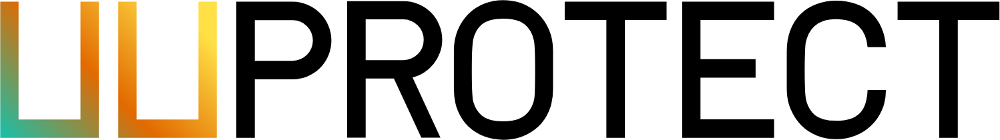

# UUPROTECT

<p align="center">
  
</p>

<p align="center">
  <strong>UUPROTECT</strong> is an open-source antivirus solution with a scanning engine, Electron desktop interface, CLI, and daemon mode.
</p>

<p align="center">
  <a href="https://github.com/OBSDESIGN/UUPROTECT/blob/main/LICENSE"></a>
  <a href="https://github.com/OBSDESIGN/UUPROTECT"></a>
  <a href="https://github.com/OBSDESIGN/UUPROTECT/releases"></a>
</p>

## Author & Credits
- **Project:** UUPROTECT
- **Creator:** **Omar Ben Sabyh**
- **License & Ownership:** **OBS DESIGN**
- **Instagram:** If you'd like to follow me, find me on Instagram at [@omar_ammor78](https://www.instagram.com/omar_ammor78/)

## Overview
UUPROTECT is a cybersecurity project that combines a **Python antivirus engine**, **command-line tools**, and a **desktop graphical interface** to scan files, folders, and archives (including ZIP and other supported formats), with result summaries, history, settings, and scheduled automatic scans.

Keywords: open source antivirus, malware scanner, virus scanner, desktop antivirus, Electron app, Python antivirus engine, ZIP archive scanning, Windows security, CLI antivirus, antivirus daemon.

## Key Features
- **Comprehensive scanning:** files, folders, and archives (including ZIP and other supported formats)
- **Preset scans:** full PC, user folder, and other quick targets
- **Drag & drop:** drag files/folders into the interface to start analysis
- **Desktop interface:** Electron UI with progress, activity status, indicators, and summaries
- **History & settings:** local storage of configurations and scan results
- **Automatic scans:** scheduling via Windows Task Scheduler
- **Issue remediation:** disinfection/remediation attempts when supported by the engine
- **CLI & daemon:** terminal usage (`uuprotect`, `k2`) and client/server components (`uuprotectc/k2c`, `uuprotectd/k2d`)

## Project Components
- **`uuprotect/`**: scanning engine, plugins, core, CLI, and daemon
- **`electron-ui/`**: desktop application (React, Vite, Electron, TypeScript, Tailwind)
- **`Tools/`**: utilities for signatures/rules and support tools
- **Launch scripts:** `Avvia UUPROTECT.bat`, `Avvia-UUPROTECT.bat`

## Requirements
- **Windows** (primary support for UI and automatic scheduling)
- **Python 3.10+**
- **Node.js + npm** (for Electron UI development/build)
- Python dependencies listed in `pyproject.toml` (some optional features require extras)

## Quick Start (Engine & CLI)
```bash
git clone https://github.com/OBSDESIGN/UUPROTECT.git
cd UUPROTECT
python -m venv .venv
# Windows
.venv\Scripts\activate
pip install -e .
```

Install with daemon support:
```bash
pip install -e .[daemon]
```

Install for development (tests/lint/tooling):
```bash
pip install -e .[dev]
```

## Usage
### Desktop UI (Windows)
- Double-click `Avvia UUPROTECT.bat`
- Or run `\.venv\Scripts\uuprotect.exe` (alias: `k2.exe`)

### CLI
```bash
# Basic scan
.\.venv\Scripts\uuprotect.exe --no-gui <path>

# Compatible aliases
.\.venv\Scripts\k2.exe --no-gui <path>
```

## Desktop UI Development (Electron)
```bash
cd electron-ui
npm install
npm run build
npm run electron
```
For development with Vite:
```bash
npm run dev
```

## Configuration
- Environment variables and rule/paths can be configured via `.env` (see `.env.example`).
- The desktop app stores settings and history in a local user data directory (Electron `userData`).
- Scheduled automatic scans on Windows may require appropriate permissions to create/update scheduled tasks.

## Security & Disclaimer
UUPROTECT is provided as open-source software for analysis and protection purposes, **without warranties** of complete detection or absence of false positives/negatives. Before disinfection or removal actions, verify results and keep backups of important data.

For vulnerability reports or security issues, see [SECURITY.md](SECURITY.md).

## Contributing
Contributions are welcome (bug fixes, UI/engine improvements, documentation, tests). See [CONTRIBUTING.md](CONTRIBUTING.md) for guidelines on issues, branches, commits, and pull requests.

## Repository Structure
```text
.
├─ uuprotect/          # Antivirus engine, plugins, CLI, daemon
├─ electron-ui/        # Desktop interface (React + Electron)
├─ Tools/              # Utilities and support tools
├─ assets/             # Graphic assets (logo, etc.)
├─ .github/            # Templates and CI workflows
├─ README.md
├─ LICENSE
├─ CONTRIBUTING.md
├─ SECURITY.md
├─ CHANGELOG.md
└─ pyproject.toml
```

## SEO & Repository Discoverability
This repository is optimized for discoverability with clear descriptions, relevant keywords (antivirus, malware scanner, open source security, Python, Electron, Windows), structured documentation, and standard community files. To further improve visibility on GitHub:
- set **About/Description** and **Topics** for the repository (e.g. `antivirus`, `malware-scanner`, `security`, `python`, `electron`, `windows`, `open-source`, `cybersecurity`)
- publish releases with notes and assets
- keep README, changelog, and issue templates up to date

## License
This project is distributed under the **MIT License** owned by **OBS DESIGN**. See the [LICENSE](LICENSE) file for the full text.
